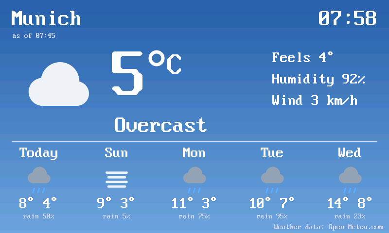

# Weather for the ESP32-P4 Launcher

A weather app for the [ESP32-P4 Launcher](https://github.com/giltal/ESP32_P4_Launcher): current
conditions and a 5-day forecast from [Open-Meteo](https://open-meteo.com/) (free for non-commercial use,
no API key, data under CC BY 4.0).



It is also an example of the launcher's **NET interface** (launcher 0.29 or newer): `up()` joins the
board's saved network, and `http_open()` / `http_read()` fetch the forecast over HTTPS. On an older
launcher the app says so instead of showing the weather.

## Use

- **Place:** tap the screen (or press X / START) and choose **Place**. Type a city on the on-screen
  keyboard (touch, or a gamepad: D-pad moves, A types, B deletes, START searches) or on a USB keyboard,
  then pick one of the matches from Open-Meteo's geocoding search.
- **Units:** **Units** in the same menu switches between metric and imperial.
- **Settings file:** both are kept in `/sd/data/chneeb.weather/weather.txt` (Munich on the first start),
  which can also be edited on a PC or with the launcher's Wi-Fi file manager:
  ```
  place=Springfield, Illinois
  units=metric
  ```
  `place` is a city, optionally with a country name, country code or region after a comma; the app looks
  it up when it changes and writes `name`, `lat` and `lon` back. Without a `place` line, `lat` and `lon`
  are used as they are.
- **Controls:** A refreshes; X, START or a tap opens the menu (Refresh, Place, Units, Exit). The app refreshes
  every 15 minutes.
- **Offline:** it shows the last answer (`cache.json` beside the settings) with its age.

## Build

Needs the RISC-V toolchain of ESP-IDF (as for the launcher's own apps) and a launcher checkout, 0.29 or
newer:

```
python build.py ../ESP32_P4_Launcher       # or set P4_LAUNCHER
```

The result is `build/weather.papp` and `build/icon.png`. Copy both to `/sd/apps/weather/` on the card,
or install and run it over USB with the launcher's DevLink tool:

```
python ../ESP32_P4_Launcher/tools/papp_dev.py --port <port> deploy build/weather.papp
```

`papp_text.h` is a small header-only text renderer (the launcher's 8x16 font plus °, umlauts and
smooth big digits), kept here so the app needs nothing from the SDK beyond the NET interface.

## License

MIT (see LICENSE). Weather data by [Open-Meteo.com](https://open-meteo.com/), CC BY 4.0.
